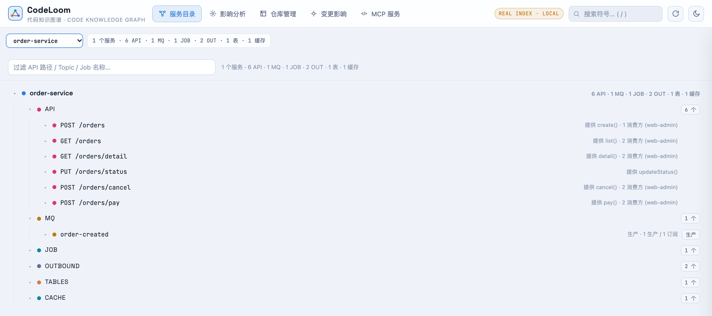
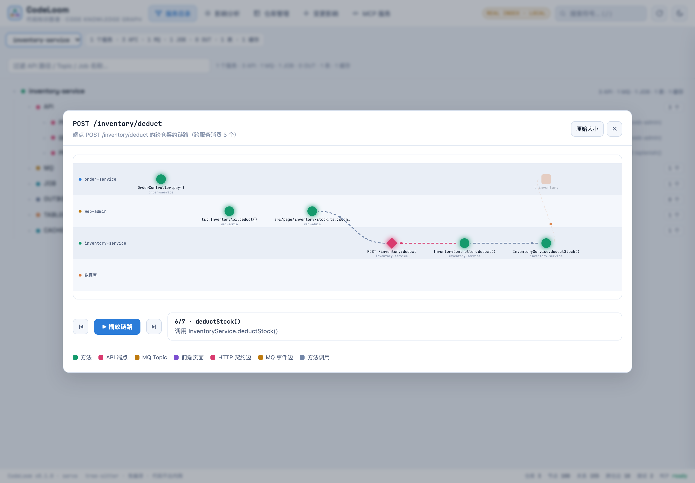

# CodeLoom

[English](README.en.md) | [简体中文](README.md)

[](https://github.com/guoan1tang/codeloom/actions/workflows/ci.yml)
[](https://www.npmjs.com/package/codeloom-cli)
[](LICENSE)

Code knowledge graph for agents. Indexes any Git repository into a method-level call graph,
stitches cross-service contracts (Feign / HTTP / MQ) across repositories, and serves it to
coding agents over MCP.

**Zero native dependencies.** Parsing is tree-sitter WASM, storage is Node's built-in SQLite,
MCP is the official SDK. No compilation, no database service, no Docker. Your code never
leaves your machine.

## Quick start

```bash
# 1. Index a repository — local path or Git URL
npx codeloom-cli analyze <path|git-url>

# 2. Open the service tree
npx codeloom-cli serve            # http://127.0.0.1:3111

# 3. Hand it to your agent
claude mcp add codeloom -- npx -y codeloom-cli mcp
```

Then ask your agent: "What APIs and tests are affected if I change `OrderService.create`?"
Indexing is incremental — re-running `analyze` only parses changed files.

## Screenshots

Service tree — one tree per service: API / MQ / JOB / OUTBOUND / tables / cache, with cross-service consumers labelled on the right:



Click 「链路」 on any API to see the stitched cross-repo contract (frontend page → Feign caller → provider → table):



## Use with agents (MCP)

The MCP server exposes 9 tools over stdio against the same local graph. One line in Claude Code:

```bash
claude mcp add codeloom -- npx -y codeloom-cli mcp
```

Other MCP clients (Cursor, Claude Desktop, …) use a JSON config:

```json
{
  "mcpServers": {
    "codeloom": { "command": "npx", "args": ["-y", "codeloom-cli", "mcp"] }
  }
}
```

Then just ask:

- "What APIs, pages and tests are affected if I change `OrderService.payOrder`?"
- "Who consumes `POST /inventory/deduct`, and how does the cross-repo call get there?"
- "Turn the current git diff into a test checklist" (`impact_of_diff` → `tests_for_change` → `graph_status`)
- "Which methods read or write `t_order`? Who uses the `order` cache key?"

The agent gets method-level call chains, contract edges (Feign / HTTP / MQ) and data-layer edges (tables / caches), each carrying a confidence level (certain / inferred / speculative) so uncertain hops are stated as such. Full tool list under [MCP tools](#mcp-tools).

## Install

Requires Node >= 22.13 and Git. The `npx` flow above needs no install; you can also install globally:

```bash
npm i -g codeloom-cli
```

### Without npm (install straight from GitHub)

```bash
npx -y github:guoan1tang/codeloom analyze <path|git-url>
claude mcp add codeloom -- npx -y github:guoan1tang/codeloom mcp
```

This clones the repository and runs it through Node — no registry account needed.

## Web UI

```bash
codeloom serve                 # http://127.0.0.1:3111
```

Browser UI over the live index. Default view is a service tree — one service at a
time (switchable): root service → API / MQ / JOB groups → entries with provider
methods and cross-service consumers (expandable); click any row for real source
snippets from your local checkout. Also ships impact analysis, a per-endpoint cross-repo
chain popup opened from tree rows (swimlane playback, real contracts), an agent-loop runner (commit/diff → impact →
precise test selection), repository management (add / reindex / remove), and a query
console sharing the MCP engines. Binds 127.0.0.1 only — keep the index local.

## Configuration (global, UI or file)

Open **Repositories → 全局配置** in the web UI to edit gateway prefix rules and framework
adapters. Global config is stored in the graph database and applies to every repository
at index time; saving can rebuild all indexes in one click.

Per-repository `codeloom.config.json` remains supported for exceptional repos only
(precedence: defaults < global < repo file).

### Options

Place `codeloom.config.json` at the repository root to adapt framework conventions
(all keys optional; generic Spring defaults apply):

```json
{
  "httpWrappers": ["HttpApi", "request"],
  "pathAliases": { "@src/*": "src/*", "@/*": "src/*" },
  "pageDirs": ["src/page", "src/pages", "src/views"],
  "jobAnnotations": ["Scheduled", "XxlJob", "ElasticSimpleJob"],
  "mqListenerAnnotations": ["RabbitListener", "KafkaListener"],
  "tableAnnotations": ["TableName", "Table"],
  "gatewayRouters": [{ "prefix": "/api-order", "strip": 1 }],
  "gatewayRoutesFile": "config/gateway-routes.yaml"
}
```

- `gatewayRouters` / `gatewayRoutesFile` (Spring Cloud Gateway yaml: `Path=/prefix/**` + `StripPrefix=n`)
  strip service prefixes from consumer paths at index time, so frontend/Feign calls join backend endpoints.
- HTTP wrappers can be auto-detected (files importing axios) or listed explicitly by identifier.

## CLI

```bash
codeloom analyze <path|git-url> [--name n] [--branch b] [--full] [--db path]
codeloom list
codeloom status [--json]
codeloom remove <name>
codeloom mcp [--db path]
codeloom serve [--port 3111] [--host 127.0.0.1]
```

- `analyze` is incremental: unchanged files (content hash) are skipped. `--full` re-parses
  everything and refreshes cross-file interface dispatch.
- Default database: `~/.codeloom/graph.db` (override with `--db` or `CODELOOM_DB`).
- Indexing a URL clones to a temp dir and deletes it afterwards; only the graph persists.

## MCP tools

| Tool | Purpose |
|---|---|
| `search_symbol` | Find methods / types / endpoints / topics / pages / tests by name, FQN or path |
| `find_callers` / `find_callees` | Depth-limited call traversal with confidence filter |
| `impact_analysis` | Changed method → entry points (HTTP, pages, MQ consumers, jobs, tests) |
| `cross_repo_trace` | Providers / consumers / topics stitched around an endpoint, with docs, file:line, and the tables / caches read or written along the chain (`depth` 1–6) |
| `graph_query` | Single-hop Cypher subset: `MATCH (a:Method)-[:CALLS]->(b) WHERE a.name='x' RETURN b` |
| `impact_of_diff` | Unified diff (or commit in a local checkout) → batch impact per entry point |
| `tests_for_change` | Precise test selection: unit tests + bridged API/UI cases + uncovered risk |
| `graph_status` | Indexed commits, freshness warnings, static test coverage per repo |

Data-layer edges: DB tables (MyBatis XML mappers, @Select/@Insert/@Update/@Delete, SQL string literals) via READS_TABLE/WRITES_TABLE, and Redis/cache keys via USES_CACHE; the tree-row chain popup shows 数据库/Redis lanes downstream of provider methods.

Call edges carry confidence: `certain` (direct), `inferred` (unique interface impl / DI),
`speculative` (multiple candidates). Traversal defaults to certain+inferred; high fan-in
utility methods are truncated from impact chains (default threshold 30, configurable).

## What gets extracted

- **Java**: classes / interfaces / methods, imports, extends / implements, call sites with
  receiver resolution (fields, locals, params, `new`), Spring DI dispatch, `@RestController`
  mappings → endpoints, `@FeignClient` → consumer edges, RocketMQ / Kafka listeners and
  producer sends → topics, `@Scheduled` → job entries, JUnit `@Test` / `src/test` → test nodes.
- **TypeScript / JavaScript**: imports, functions / classes / methods, calls, `fetch` /
  `axios` / `http` client calls → endpoint edges, `src/pages|views` → page nodes,
  jest `it()` / `test()` → test nodes.
- **Cross-repo**: endpoints and topics are global join keys — a Feign client in repo A and a
  controller in repo B meet on the same endpoint node. Endpoints with no provider are marked
  external boundaries.

## Language packs

A pack is a module exporting `extensions`, `grammar` (a `tree-sitter-wasms` name),
`pass1(ctx, tree)` (symbols + contracts + call sites) and `pass2Types` / `pass2Calls`
(cross-file resolution). See `src/packs/java.js` and `src/packs/typescript.js`.
Adding a language = adding a pack; the core, storage, traversal and MCP surface are
language-agnostic.

## Limitations (P0)

- Syntax-level resolution: reflection, AOP proxies and dynamic dispatch are invisible.
  Edges say what the code states, not what the runtime does — confidence is exposed so
  agents can reason about it.
- Gateway route rewriting (prefix stripping) is not yet ingested; consumer paths must match
  provider paths after normalization (`:id` / `{id}` / `${…}` → `{param}`).
- Incremental re-parse refreshes dispatch edges for changed files only; use `--full` after
  adding implementations of existing interfaces.
- Overloads resolve to the first matching method name.
- Case nodes (`COVERS` edges) are ingested from your test-management export; the bridge
  format is documented in `src/graph.js` (`testsForChange`).

## Capability tests

Sample projects live in `test/fixtures/<name>/`; each ships an `expect.json` with declarative
graph assertions (edges, node properties, summary counts) executed by `test/harness/index.js`.
Adding a fixture requires no test code — see `test/fixtures/README.md`.

## Contributing

See [CONTRIBUTING.md](CONTRIBUTING.md). Capability fixtures live in `test/fixtures/` —
adding a project structure is a directory plus an `expect.json`, no test code.

## Development

```bash
npm install --registry=https://registry.npmmirror.com   # or your registry
npm test                                               # 40 tests: fixtures, MCP, API, perf smoke
```

## License

Apache-2.0