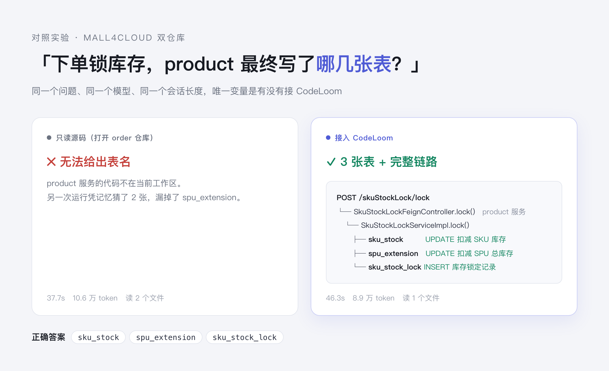
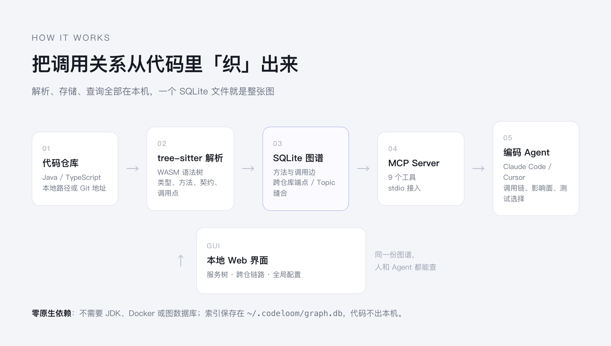
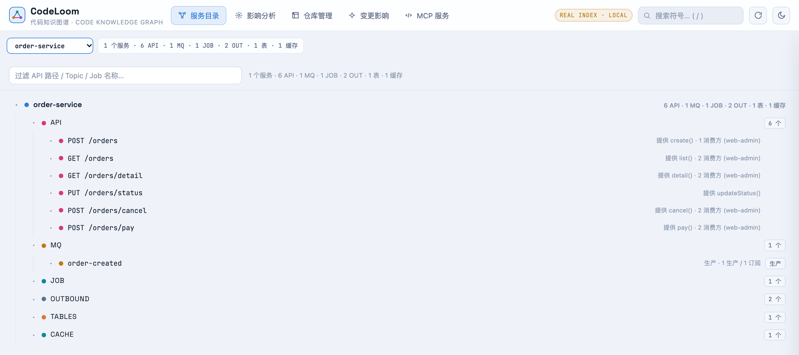
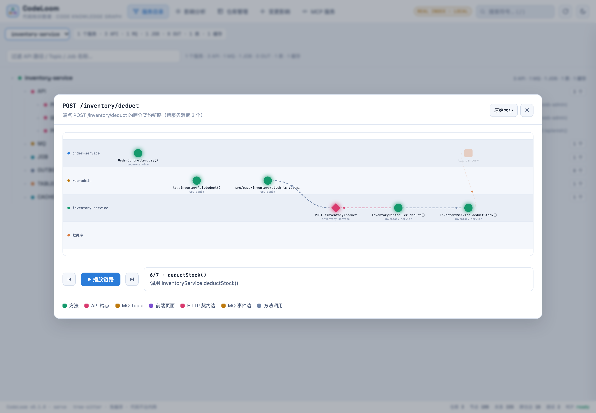

# 让 Agent 跨仓库查代码：我做了个 MCP 知识图谱，同一问题省 46% token

> 备选标题：
> 1. 同一个问题，Claude Code 答不出来，接上这个 MCP 后答对了
> 2. 我给编码 Agent 装了一张「代码地图」，实测数据都在这里

先说一个我反复遇到的场景。

订单服务要扣库存，代码在 `mall4cloud-order`；真正改库的实现在 `mall4cloud-product`，是另一个仓库。我让 Claude Code 回答一个问题：

> 下单提交时订单服务调用 product 锁定库存，product 最终写入哪些数据库表？

它在我打开的 order 仓库里翻了一遍，最后很诚实地告诉我：**「product 服务的代码不在这个工作区，无法给出表名。」**

另一次它凭印象猜了两张表，漏掉了 `spu_extension`。



这不是模型不努力，是它手里只有「文件」，没有「关系」。

所以我做了 **CodeLoom**：把代码仓库解析成方法级调用图，跨仓库把 Feign / HTTP / MQ 契约缝起来，再通过 **MCP** 交给编码 Agent。

## 它到底有没有用，我做了对照实验

不吹「提效 10 倍」。方法写清楚：同一个 Claude Code CLI、同一个模型、同一组问题，唯一变量是**有没有接 CodeLoom**。两条臂都只允许读文件 / 搜索（Read、Grep、Glob），禁用 Bash；记录耗时、token（含缓存读写）、费用、读文件数和答案正确性。

### 实验一：单仓库，ruoyi-vue-pro（7,673 个 Java 文件）

问题：`GET /system/user/page` 的完整调用链，以及它读了哪些表。

- 不接 CodeLoom：**114 秒**，25.9 万 token，grep 16 次、读 3 个文件
- 接上 CodeLoom：**82 秒（快 28%）**，23.5 万 token，读 2 个文件
- 两边答案都对；接上后额外标出了「哪张表是条件分支才会查」

同一项目的第二个问题（改 `AdminUserServiceImpl.updateUser` 影响哪些接口）：

- 不接：59 秒，7.1 万 token，读 1 个文件
- 接上：**47 秒，0 个源码文件**

**结论要说实话**：单仓库里，它稳定快 20–30%，能不看源码直接回答；但 **token 没有优势** —— 9 个 MCP 工具的说明书，每次会话要额外写 15–20k 缓存 token，短会话里这是净开销。

### 实验二：两个仓库，mall4cloud（order / product 拆开）

这才是它真正的主场。我把 `mall4cloud-order` 和 `mall4cloud-product` 拆成两个独立仓库，模拟真实的多仓布局，然后问最开始那个问题。

| | 只打开 order（日常状态） | 两个仓库都打开（最强基线） | **CodeLoom（只打开 order）** |
|---|---|---|---|
| 耗时 | 37.7s | 68.1s | **46.3s** |
| token | 105,876 | 164,514 | **89,511** |
| 费用 | $0.13 | $0.21 | $0.16 |
| 读文件 | 2 | 3 | **1** |
| 答案 | ❌ 答不出，或凭记忆猜错 | ✅ 3 张表 | ✅ **3 张表 + 完整链路** |


对比「两个仓库都检出」的最强基线：**省 32% 时间、46% token、22% 费用**。

对比日常「只开当前仓库」的状态：基线根本给不出可信答案，CodeLoom 给的是：

```
POST /skuStockLock/lock
└─ SkuStockLockFeignController.lock()        product 服务
   └─ SkuStockLockServiceImpl.lock()
      ├─ sku_stock        UPDATE 扣减 SKU 库存
      ├─ spu_extension    UPDATE 扣减 SPU 总库存
      └─ sku_stock_lock   INSERT 库存锁定记录
```

每一跳都带文件行号和中文注释。

**为什么这里 token 反而省了**：省的不是工具调用，是**不用把另一个仓库的源码读进上下文**。两个实验放在一起看，才是完整结论：

- 单仓库、命名规范：省时间，不省 token
- 多仓库、契约跨服务：正确性和 token 都明显占优

## 它是怎么做到的

不装 Docker、不跑 Neo4j、不需要 JDK：

- 解析：tree-sitter WASM（Java、TypeScript）
- 存储：Node 22 内置 SQLite，一个文件就是整张图
- 接口：官方 MCP SDK，stdio 接入
- 界面：本地 Web，服务 → API / MQ / JOB / 表 / 缓存的树状目录

安装三步：

```bash
npx codeloom-cli analyze https://github.com/you/your-service.git
npx codeloom-cli serve        # http://127.0.0.1:3111
claude mcp add codeloom -- npx -y codeloom-cli mcp
```

代码不出本机；索引存在 `~/.codeloom/graph.db`。



打开界面就是一张服务树，一个服务一棵：API / MQ / JOB / 数据表 / 缓存，右侧直接标出跨服务消费方。



点任意 API 的「链路」，看跨仓库调用契约（前端页面 → Feign 调用方 → 提供方 → 数据表）。



Java 常见写法基本覆盖：`@RestController` / `@Controller`、Feign 接口 + implements 契约、Spring DI 分派、RabbitMQ / Kafka / RocketMQ、`@Scheduled` / `@XxlJob`、MyBatis XML / `@Select` / BaseMapper / 自定义 `BaseMapperX` / `ServiceImpl`、`lambdaQuery`、`@Cacheable` / Redis 键。连「把 Registry 传给分页工具类执行查询」这种委托写法，也能把表归属回调用方。

## 它做不到什么（请一定看）

- **语法级解析**：反射、AOP 代理、动态分派看不见。每条调用边都标了置信度（确定 / 推断 / 推测），Agent 会说明哪一跳不确定
- **外部依赖会断链**：Feign 接口定义在没索引的仓库或 jar 里，链路就停在那里
- **网关前缀要配置**：前后端路径对不上时，在界面「全局配置」里配一次
- **以 Java 为主**，TypeScript 覆盖常用写法；Go、Python 还没做
- 索引是静态快照，代码改了要重新 `analyze`（增量，几千文件通常几秒）

## 适合谁

- 后端是 Java / Spring，服务多、仓库多，Feign / MQ 关系靠人记
- 已经在用 Claude Code / Cursor，但 Agent 经常「看不到全貌」
- 想给新人一个能查「这个接口到底走哪条链路」的工具

如果只有一个单体小项目，或者主要写 Go / Python，现在不用装 —— 单仓库里 grep 已经够用，装了只是多花 token。

---

项目 Apache-2.0 开源，叫 **CodeLoom**。

- GitHub：https://github.com/guoan1tang/codeloom
- npm：`npm i -g codeloom-cli`
- 完整评测方法、数据表和复现命令：`docs/benchmark.md`

如果它帮你省下了一次跨仓库翻代码的时间，欢迎点 Star；用出问题直接提 Issue，我优先修真实项目里踩到的坑。

---

## 发布备注（不发布）

- 配图：README 里的「服务树」「跨仓库链路」两张截图；数据表建议做成图片或卡片排版，直接粘 Markdown 表格在公众号编辑器里会散
- 评论区高频问题预案：
  - 「代码会不会上传？」→ 不会，本地 SQLite，索引在 `~/.codeloom/graph.db`
  - 「支持 Go / Python 吗？」→ 暂不支持，Java 优先，TypeScript 覆盖常用写法
  - 「和 Sourcegraph / GitNexus 有什么区别？」→ 本地零依赖、MCP 原生、面向 Agent 的调用链和影响面，不替代代码搜索
  - 「公司私有 npm 源装不上」→ 加 `--registry=https://registry.npmjs.org/`